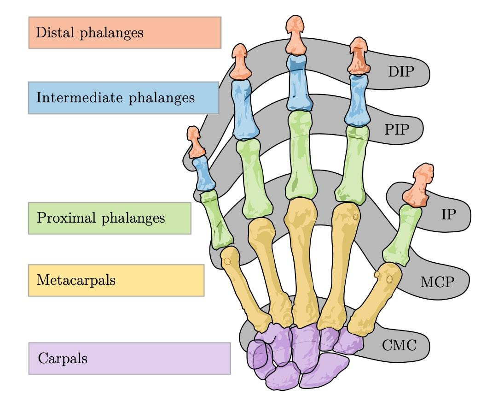

以21个自由度的建模方式为例，讲解人手自由度。

## 1. 人手主要关节

|关节	|英文	|主要运动|
|------|------|------|
|掌指关节	|MCP	|手指弯曲、伸展，以及侧摆|
|近端指间关节	|PIP	|手指弯曲、伸展|
|远端指间关节	|DIP	|指尖弯曲、伸展|
|拇指掌腕关节	|CMC	|拇指对掌、外展等|
|拇指掌指关节	|MCP	|拇指弯曲、伸展|
|拇指指间关节	|IP	|拇指末端弯曲、伸展|

## 2. 自由度

自由度（DoF, Degree of Freedom）：一个物体能独立运动的方式数量，每一种独立、互不干扰的运动，就是 1 个自由度。

### 1. 拇指外四指

4 DoF：DIP（屈伸） + PIP（屈伸） + MCP（屈伸、外展内收）

### 2. 拇指

5 DoF：IP（屈伸） + MCP（屈伸）+ CMC（屈伸、外展内收、轴向旋转）

- 屈伸：抬起压下，也就是上下旋转。
- 外展内收：大拇指离开手掌、贴向手掌，也就是左右。
- 轴向旋转：扭转，也就是竖着转动。

### 3. 主动自由度与被动自由度

- 主动自由度：能够独立主动控制的运动维度。
- 被动自由度：能够运动，但没有独立主动控制的维度。

### 4. 全驱动与欠驱动

- 全驱动：每个目标自由度都有独立驱动。
- 欠驱动：驱动数量少于机械自由度数量。

## 3. 机械臂

机械臂的轴数通常就相当于它的运动自由度数量。