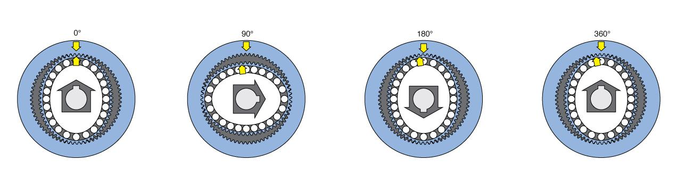

## 1. 定义

谐波减速器（Harmonic Drive）是一种精密减速装置，主要用于机器人关节、机械臂、航空航天设备等需要高精度运动控制的场景。

作用：降低电机转速，提高输出扭矩，同时保证输出运动的精确性。

## 2. 基本结构

电机输出轴（外部部件）带动波发生器旋转，提供动力。

波发生器使柔轮产生周期性弹性变形，并推动啮合区域沿圆周移动。

柔轮齿数少于刚轮，在齿轮啮合约束下产生缓慢旋转，作为输出端。

刚轮通常固定在减速器壳体上，作为固定端。

### 1. 波发生器

通常由椭圆形凸轮和柔性轴承组成，负责产生周期性的椭圆形变形。

横截面：
```
中心 -> 边缘

电机输出轴  - 椭圆凸轮（刚性）- 柔性轴承（内圈 + （保持架 + 滚动体） + 外圈）
```

### 2. 柔轮

一种具有弹性的薄壁金属齿轮，可以在波发生器作用下产生弹性变形。

### 3. 刚轮

一个刚性的内齿圈，与柔轮啮合，通常比柔轮多几个齿。

## 3. 降低电机转速



减速比i = 柔轮齿数 / ( 刚轮齿数 - 柔轮齿数 )

电机带动波发生器旋转i圈，柔轮输出端就反向旋转1圈。

## 4. 提高输出扭矩

机械功率：

P：功率。
T：扭矩。
ω：角速度。

```
P = T * ω
```

理想情况下功率守恒：

输入功率 = 输出功率

```
T1 * ω1 = T2 * ω2
```

减速后，输出的角速度降低，扭矩变大。