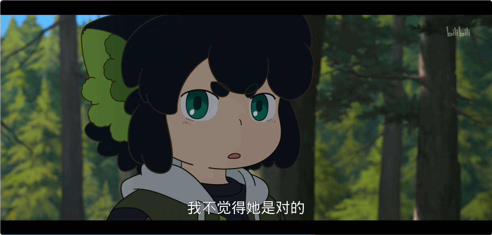
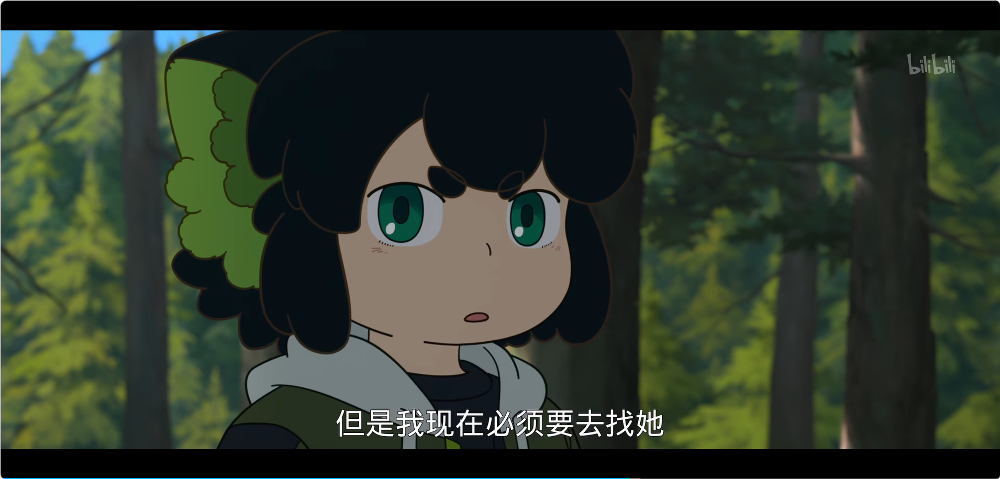

每个人都在坚持做自己认为正确的事情。

不要为了接近执念，而放弃自己现有的幸福。没有什么比现在与未来更重要，哪怕是过去的自己。人不能逆大势所趋，除非坚定要牺牲自己。

风息变成了公园，最终可能还是会被他最讨厌的人类砍了做木材。

鹿野走出执念，着实伟大，如果她坚持与人类为敌，会耽误自身的成长，也要面临被毁灭的风险。

无限足够强大，即使是为妖精做事，因为有人类的身份，还是避免不了部分妖精的忌惮。

是好是坏谁说得准，不到最后一刻，谁会想到风息和灵遥想置小黑与鹿野于死地。一同享受过温馨的时光，将回忆存档，组成生命的意义。

不够强大时，不要硬出头。皆逆荒拿金属小刀刺杀鹿野，没用，反手被收入囊中。

小黑有无限和鹿野。现实中，会遇到千千万万人助我成长，慢慢蒸馏，人要做自己的无限和鹿野。

